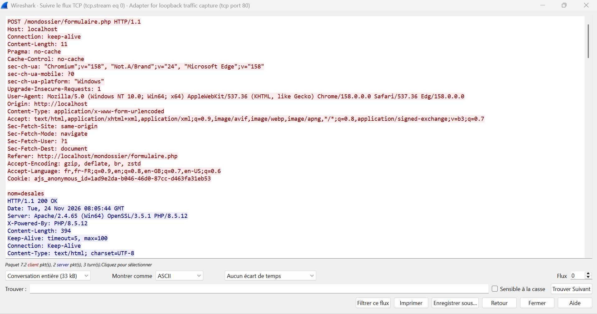
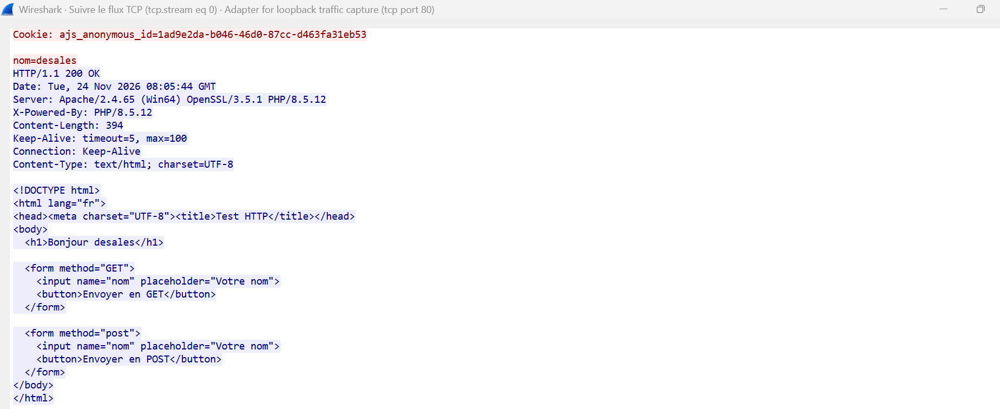
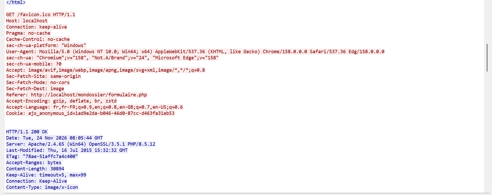
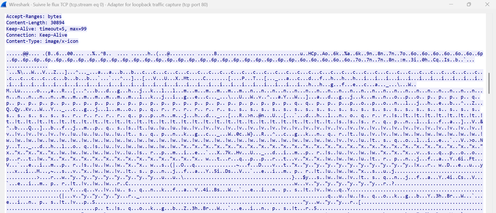

# DIOMANDE GNAN DESALES YENEKA ING 2    

# Compte rendu : Observer HTTP, du navigateur à Wireshark

## Partie 1 : Observer dans le navigateur

### Étape 1 : Requête simple (formulaire.php)

| Élément à relever | Où le trouver | Valeur observée |
| --- | --- | --- |
| Méthode | En-têtes, ligne de requête | GET |
| URL complète | En-têtes | http://localhost/mondossier/formulaire.php |
| Code de statut | En-têtes, ligne de statut | 200 OK |
| Version de HTTP | En-têtes | HTTP/1.1 |
| Host | En-têtes de requête | localhost |
| User-Agent | En-têtes de requête | Mozilla/5.0 (Windows NT 10.0; Win64; x64) AppleWebKit/537.36 (KHTML, like Gecko) Chrome/158.0.0.0 Safari/537.36 Edg/158.0.0.0 |
| Content-Type | En-têtes de réponse | text/html; charset=UTF-8 |
| Content-Length | En-têtes de réponse | 394 |
| Server | En-têtes de réponse | Apache/2.4.65 (Win64) OpenSSL/3.5.1 PHP/8.5.12 **x** |
| Durée totale | Onglet Délais (Timings) | 122 ms |

## Partie 3 : Wireshark

### Étape 4 : Lire les couches

| Couche (cours, ch. 1.4) | Ligne dans Wireshark | Information à relever | Valeur observée |
| --- | --- | --- | --- |
| Accès réseau | Null/Loopback ou Ethernet II | Type de trame | Null/Loopback (Windows) ou Ethernet II sur lo&#32; Family: IPv6 (24) |
| Internet | Internet Protocol | Adresse source, adresse destination | &#32;::1 → ::1&#32; |
| Transport | Transmission Control Protocol | Port source, port destination | port source : 80 → port destination : 51203 |
| Application | Hypertext Transfer Protocol | Méthode, chemin, en-têtes | POST , /mondossier/formulaire.php; localhost, Mozilla/5.0 (Windows NT 10.0; Win64; x64) AppleWebKit/537.36 (KHTML, like Gecko) Chrome/158.0.0.0 Safari/537.36 Edg/158.0.0.0, Accept : text/html,application/xhtml+xml,application/xml;q=0.9,image/avif,image/webp,image/apng,\*/\*;q=0.8,application/signed-exchange;v=b3;q=0.7, keep-alive |

### Étape 5 : Poignée de main TCP

Schéma du dialogue client-serveur :

&#91;embedded content: poignée de main TCP · 3 paquets puis requête HTTP\]

### Étape 6 : Flux TCP suivi

Capture d'écran : 

## Questions

### 1. Pourquoi dit-on que HTTP est sans état ? Qu'est-ce qui permet malgré tout au serveur de reconnaître un visiteur ?

HTTP est dit « sans état » (*stateless*) parce que chaque requête est traitée de façon totalement indépendante : le serveur ne garde aucune mémoire des requêtes précédentes du même client. Pour lui, une requête est un échange isolé, qui arrive avec tout ce qu'il faut pour être traitée, sans lien avec celle d'avant.

Pour reconnaître malgré tout un visiteur, on ajoute un état par-dessus HTTP :

- **Les sessions** : les données du visiteur (panier, connexion) sont stockées côté serveur et retrouvées grâce à l'identifiant du cookie.
- **Les paramètres d'URL** ou les champs cachés de formulaire, plus rarement.

### 2. Où se trouvent les données d'un formulaire envoyé en GET ? en POST ? L'une des deux est-elle sûre sans HTTPS ?

- **En GET**, les données sont dans l'URL, après le point d'interrogation (?nom=...). Elles arrivent en PHP dans $\_GET. Elles sont visibles dans la barre d'adresse, l'historique, les favoris et les journaux du serveur.
- **En POST**, les données sont dans le corps de la requête, encodées selon le Content-Type (application/x-www-form-urlencoded pour un formulaire classique). Elles arrivent en PHP dans $\_POST. L'URL ne change pas.

Aucune des deux n'est sûre sans HTTPS. POST évite seulement que les données restent dans l'URL, l'historique ou les journaux, mais le corps de la requête circule en clair : l'étape 7 de la partie 3 montre que Wireshark affiche le nom saisi (HTML Form URL Encoded) en clair. Un mot de passe envoyé en POST sur HTTP est donc lisible par quiconque capture le trafic. Seul HTTPS protège réellement les données.

### 3. Que contient la réponse à une requête HEAD ? (Test avec curl -I)

on le résultat suivant :

&#32;C:\\Users\\DIOMANDE DESALES>curl.exe -I <http://localhost/mondossier/formulaire.php>

HTTP/1.1 200 OK

Date: Tue, 24 Nov 2026 08:25:11 GMT

Server: Apache/2.4.65 (Win64) OpenSSL/3.5.1 PHP/8.5.12

X-Powered-By: PHP/8.5.12

Content-Type: text/html; charset=UTF-8

La réponse à une requête HEAD contient exactement les mêmes **en-têtes** que celle d'une requête GET sur la même ressource (ligne de statut, Date, Server, Content-Type, Content-Length, Last-Modified, ETag...), mais **sans corps** : aucune page HTML n'est renvoyée.

La commande curl -I http://localhost/mondossier/formulaire.php envoie une requête HEAD et affiche uniquement ces en-têtes.  ouvrir une connexion TCP ? À quoi sert chacun ?

Il faut **3 paquets** : c'est la poignée de main en trois temps (*three-way handshake*).

1. **\[SYN\]** : le client demande l'ouverture de la connexion et propose son numéro de séquence initial.
2. **\[SYN, ACK\]** : le serveur accepte, acquitte le numéro du client et envoie son propre numéro de séquence initial.
3. **\[ACK\]** : le client confirme avoir reçu la réponse du serveur. La connexion est établie et HTTP peut commencer.

### 5. Quelles informations Wireshark montre-t-il pour un site en HTTPS, et lesquelles cache-t-il ?

**Ce que Wireshark montre :**

- Les adresses IP source et destination, et les ports .
- Les requêtes DNS, qui révèlent le nom du site recherché.
- La poignée de main TCP.
- Le **Client Hello** TLS, avec le nom du site (*Server Name Indication*), les versions de TLS et les suites de chiffrement proposées.
- Le volume des données et leur taille .

**Ce que Wireshark cache :**

- L'URL complète (le chemin et les paramètres).
- Les en-têtes HTTP (cookies, User-Agent, Content-Type...).
- Le contenu de la requête, donc les données des formulaires et les mots de passe.
- Le contenu de la réponse (la page, le JSON...) et son code de statut.

Tout cela est dans les paquets **Application Data**, chiffrés et illisibles.
